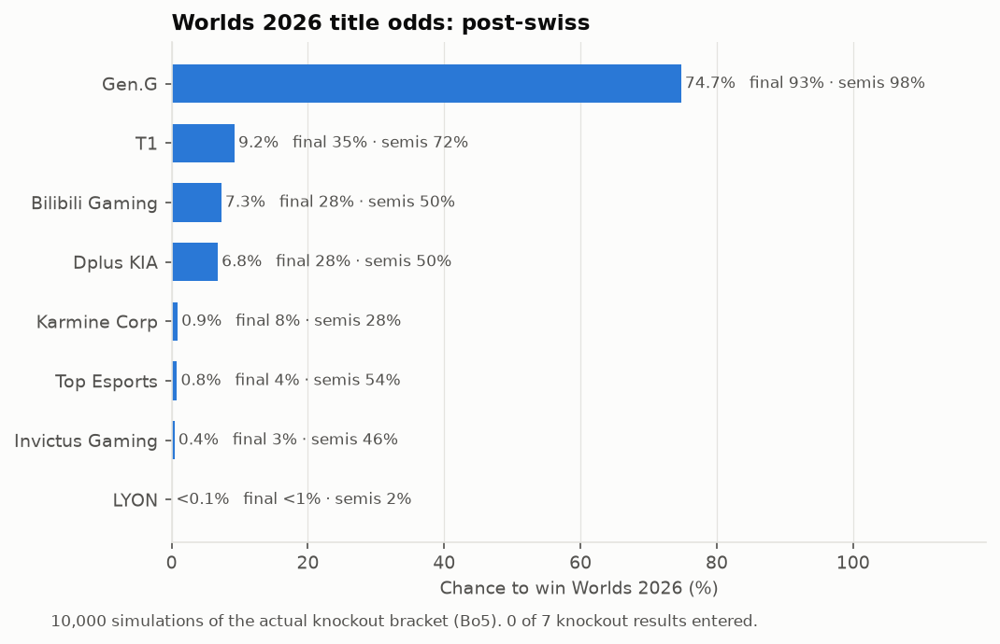
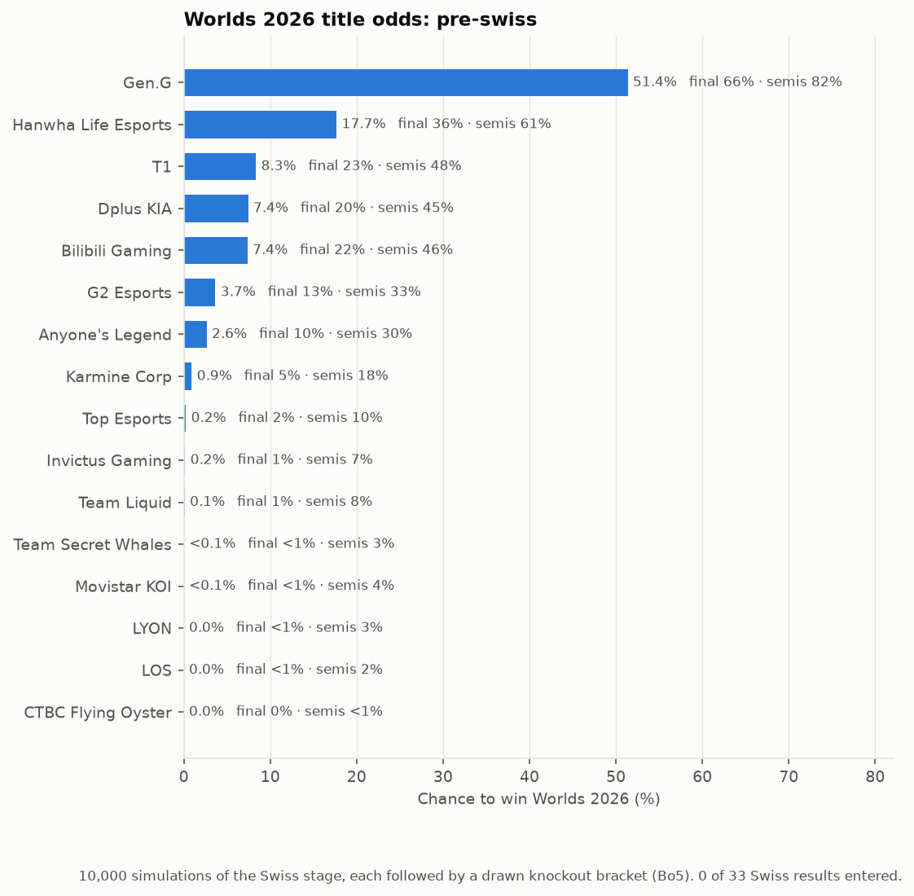
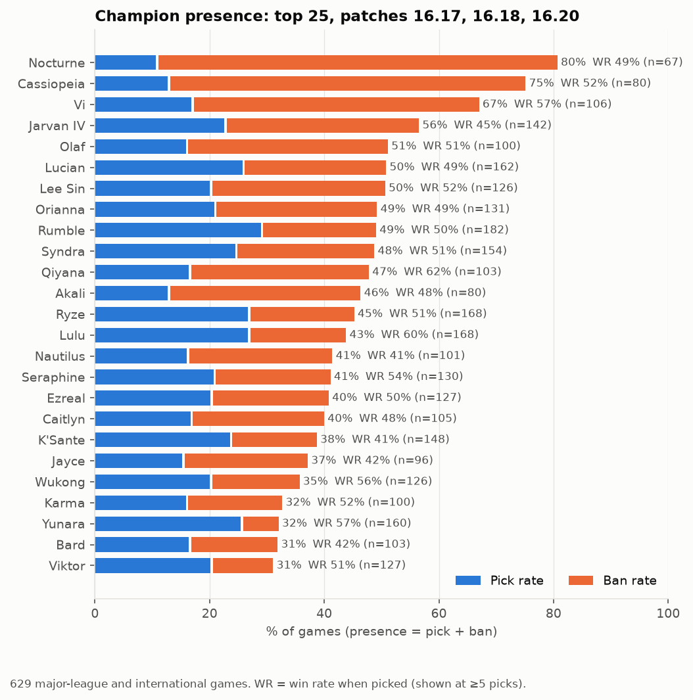
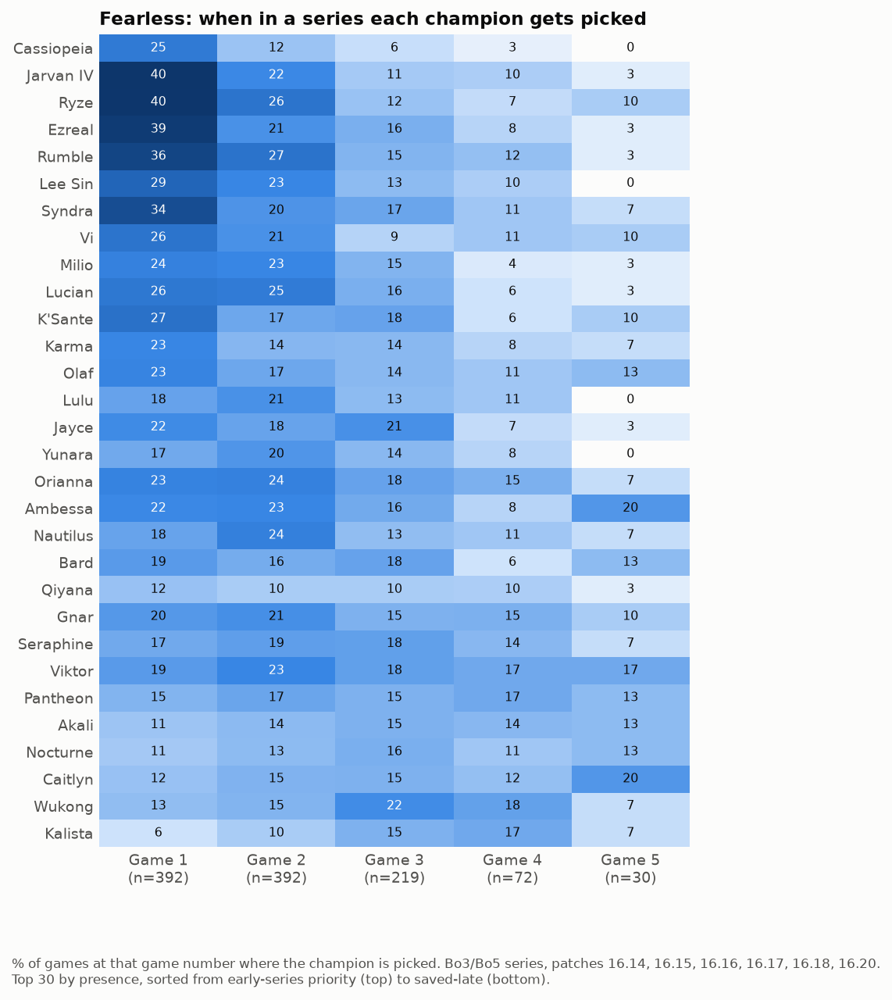
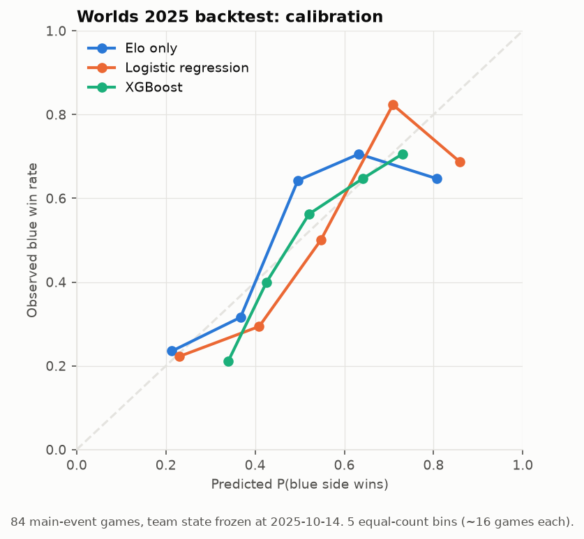
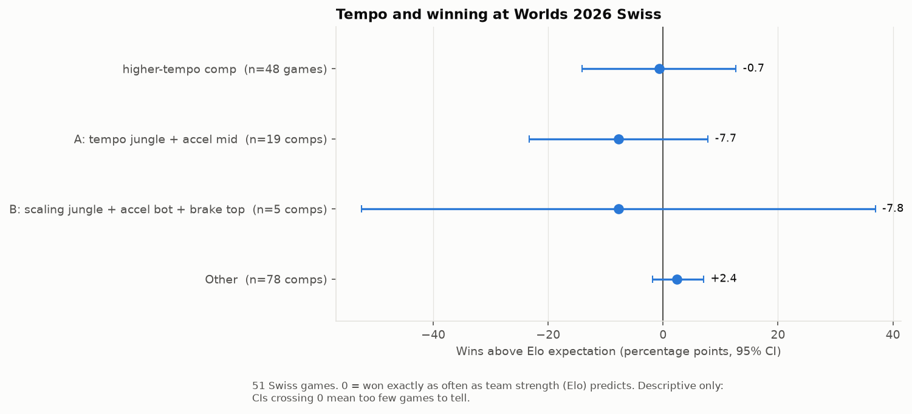
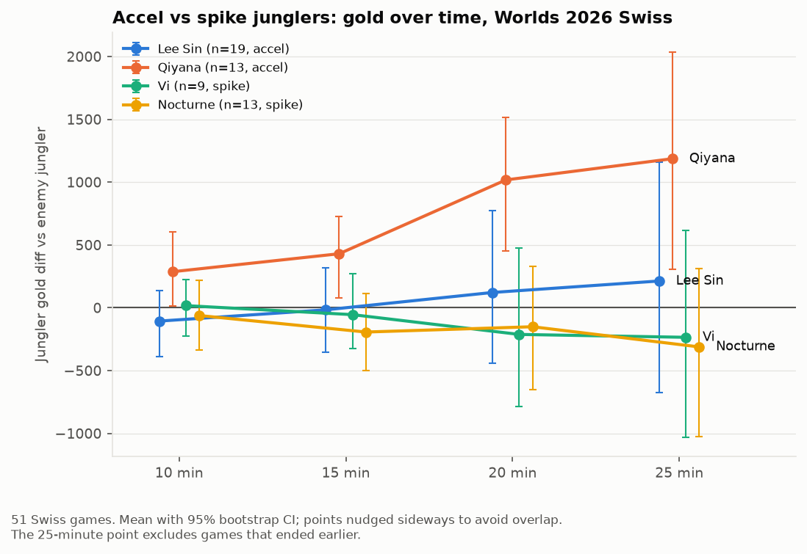
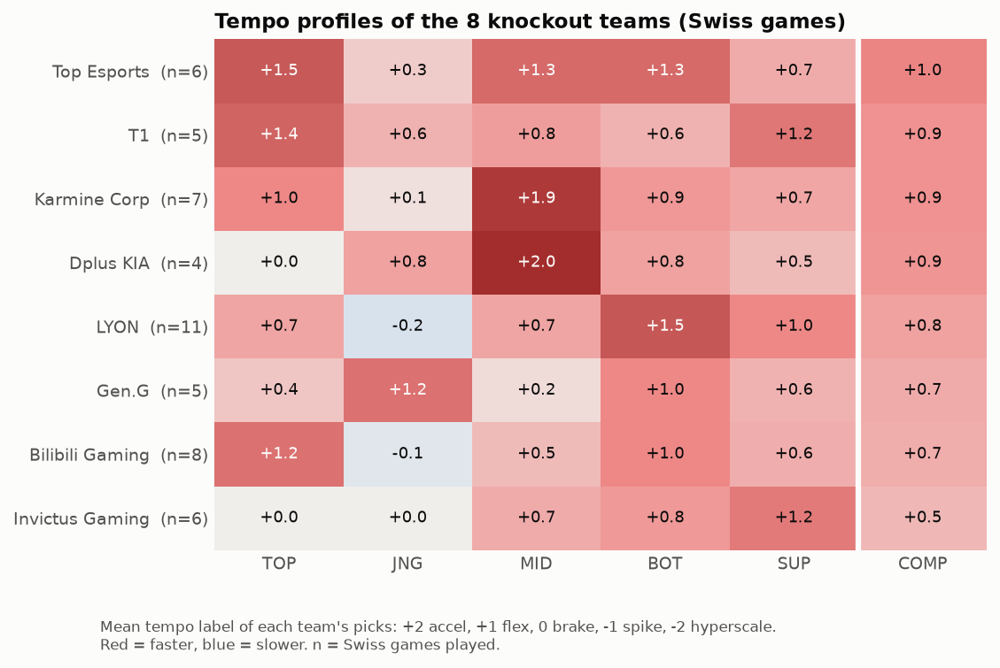

# LoL Worlds 2026 Predictor

Forecasts the League of Legends World Championship 2026 from pro match data, using a region-adjusted Elo model and a Monte Carlo simulation of the Swiss and knockout stages.



## Current prediction

**As of the quarterfinal draw, Nov 2026** (all 33 Swiss results entered; ratings use games through Oct 18, 2026; 10,000 simulations of the actual bracket)

| Team | Title chance |
|---|---|
| Gen.G | 74.7% |
| T1 | 9.2% |
| Bilibili Gaming | 7.3% |
| Dplus KIA | 6.8% |
| Karmine Corp | 0.9% |

Quarterfinals: Top Esports vs Invictus Gaming and Gen.G vs LYON on one side of the bracket, Dplus KIA vs Bilibili Gaming and T1 vs Karmine Corp on the other. Full per-team odds for reaching the semifinals, final and title are in [`outputs/sim_results.csv`](outputs/sim_results.csv).

## Odds over time

For comparison, the forecast before any Swiss match was played:



Hanwha Life Esports, the second favorite before the event (17.7%), went 2-3 and was eliminated. Gen.G went 3-0, and its title chance rose from 51.4% to 61.8%.

A snapshot is saved after every round, each in its own folder under [`outputs/snapshots/`](outputs/snapshots/), with the title odds chart, the Swiss records chart and both CSVs as they stood at that point. Every snapshot uses the same simulation seed, so a change between snapshots comes from the entered results, not from simulation noise. A line chart of every team across all snapshots is in [`outputs/odds_history.png`](outputs/odds_history.png), with the data in [`outputs/odds_history.csv`](outputs/odds_history.csv).

## How it works

```
Oracle's Elixir CSVs -> SQLite -> features -> model -> Swiss sim -> knockout sim
```

1. **CSV:** two seasons (2025 and 2026) of per-game data from Oracle's Elixir: 19,797 games and 647 teams.
2. **SQLite:** the raw rows are cleaned into games, series, team and player tables. Series are rebuilt from game order, Worlds qualifiers are separated from the main event, and cross-region games are flagged.
3. **Features:** a single pass through the games in date order records each team's state *before* each game: region-adjusted Elo, recent form, form against expectations, gold difference at 15 minutes and champion pool depth.
4. **Model:** a logistic regression on the difference between the two teams' features predicts single-game win probability, and series probabilities are derived from it.
5. **Swiss sim:** 10,000 runs of the 16-team Swiss stage, with random draws within each win-loss group, no rematches, and Bo1/Bo3 by round and record.
6. **Knockout sim:** each Swiss run continues into a quarterfinal draw following the Worlds rules, then a Bo5 bracket, giving each team's title chance.

Each stage has a short write-up with the decisions made and the checks run, in [`notes/`](notes/).

## Champion analysis



Nocturne is the most contested champion on patches 16.17, 16.18 and 16.20 at 80% presence, and 70% of that is bans.



Under Fearless draft no champion repeats within a series, so the game number a champion gets picked in shows its priority. Jarvan IV and Ryze are each picked in 40% of game 1s, while Aphelios, Jinx and Thresh tend to be held for later games.

Team-level pool depth and signature champions are in [`outputs/team_pool_depth.png`](outputs/team_pool_depth.png) and [`outputs/signature_champs.png`](outputs/signature_champs.png).

## Model and backtest

The model was tested on the Worlds 2025 main event (84 games, 41 series). It was trained only on games before the event started (Oct 14, 2025), and each team's features were frozen at that date, as if the forecast had been made on day one.

| Model | Log loss | Brier score | Accuracy |
|---|---|---|---|
| 50/50 baseline | 0.693 | 0.250 | n/a |
| Elo only | 0.615 | 0.213 | 69.0% |
| **Logistic regression (used)** | **0.603** | **0.207** | **69.0%** |
| XGBoost | 0.618 | 0.213 | 70.2% |

Lower is better for log loss and Brier score. The logistic regression also had the best series-level log loss (0.525, against 0.556 for Elo only). XGBoost did not improve on it with about 2,000 training games.



Details on Elo tuning, the season-to-season rating regression and feature weights are in [`notes/03-model.md`](notes/03-model.md).

## Testing Korea's acceleration theory

Korean analyst Baram's acceleration theory (가속도 이론) sorts champions by when they want the game to be decided: **accel** (+2), **flex** (+1), **brake** (0), **spike** (-1) and **hyperscale** (-2). We used the role-by-role labels from his Worlds 2026 chart, stored as `tempo_labels` in the config, to look at what happened in the Worlds 2026 Swiss stage. The labels cover 98.2% of Swiss picks.

**What this is and isn't.** This is a descriptive look at the 51 Swiss games (Oct 23 to Oct 31, 2026), not a test of the theory in general. Knockout games are excluded. Team strength is controlled with each team's Elo before every game: "wins above Elo" is how much more often a group won than its teams' ratings predicted. Every verdict is one of "consistent with", "not consistent with" or "too few games to tell", decided by whether the 95% confidence interval excludes zero. Run it with `python -m worlds tempo`. Full numbers are in [`outputs/tempo_results.csv`](outputs/tempo_results.csv).



**H1. Do faster comps win more?**
- *Hypothesis:* the team whose picks average a higher tempo label wins more often.
- *Evidence:* in the 48 games where the two comps differed, the faster comp won 23 (47.9%, CI 34.5% to 61.7%). After accounting for team strength, it won 0.7 points *less* often than expected (CI -14.1 to +12.7). In a regression on all 51 games, with Elo held fixed, each +1 of tempo difference changed the log-odds of winning by +0.07 (CI -0.81 to +0.90).
- *Verdict:* **too few games to tell.** The data shows no edge for faster comps either way.

**H3. Comp archetypes**
- *Hypothesis:* a tempo jungler with an accel mid (archetype A), or a scaling jungler with an accel bot and a brake top (archetype B), outperforms other comps.
- *Evidence:*
  - **Archetype A** (19 comps) went 8-11, 7.7 points below Elo expectation (CI -23.3 to +7.8).
  - **Archetype B** appeared only 5 times, going 2-3 (-7.8 points, CI -52.5 to +36.9).
  - **All other comps** (78) were 2.4 points above expectation (CI -1.8 to +7.1).
  - A and B met once, and B won.
- *Verdict:* **too few games to tell** for both archetypes.



**H6. Do accel junglers lead early and fade by 20 to 25 minutes?**
- *Hypothesis:* accel junglers (Lee Sin, Qiyana) are ahead of the enemy jungler early, but their lead flattens by 20 to 25 minutes, while spike junglers (Vi, Nocturne and others) catch up.
- *Evidence:*
  - **At 10 minutes,** accel junglers were 25 gold ahead of spike junglers relative to their opponents (CI -230 to +277), with team strength accounted for. So no clear early lead.
  - **From 10 to 25 minutes,** accel junglers gained 687 gold more than spike junglers (CI -30 to +1,390). That's the opposite of fading, though the interval still includes zero.
  - **Qiyana drives most of this,** rising from +287 at 10 minutes to +1,187 at 25 (13 games). Lee Sin went from -106 to +213 (19 games), and Vi and Nocturne drifted slightly negative.
  - **Head-to-head:** Lee Sin vs Qiyana happened 5 times, with Lee Sin winning 2 and trailing by 1,463 gold at 25 minutes on average. Every other pairing had 3 games or fewer.
- *Verdict:* **too few games to tell.** If anything, the Swiss data leans against the "accel junglers fade" pattern, mostly because of Qiyana.

**H6b. Does gold convert to wins in accel vs spike jungle games?**
- *Hypothesis:* gold leads turn into wins less reliably for teams with an accel jungler, because spike junglers' mid-game impact doesn't show up in gold.
- *Evidence:*
  - **Mixed jungle games.** In the 23 games with an accel/flex jungler on one side and a spike/hyperscale jungler on the other, the accel side was ahead in team gold on average: +388 at 15 minutes, +380 at 20 and +540 at 25 (all intervals include zero). It still won only 10 of 23 (43.5%, CI 25.6% to 63.2%), 4.1 points below Elo expectation (CI -22.8 to +15.3).
  - **Converting a 1k+ lead:**

    | Team leading by 1,000+ team gold | Won | Win rate (95% CI) |
    |---|---|---|
    | at 15 min, accel/flex jungler | 9 of 16 | 56% (33% to 77%) |
    | at 15 min, spike/hyperscale jungler | 12 of 14 | 86% (60% to 96%) |
    | at 20 min, accel/flex jungler | 14 of 23 | 61% (41% to 78%) |
    | at 20 min, spike/hyperscale jungler | 15 of 20 | 75% (53% to 89%) |

  - **Gap after controlling for team strength.** Accel-jungle teams converted 15-minute leads 29.0 points less often than spike-jungle teams (CI -56.7 to -1.0). At 20 minutes the gap was 22.8 points (CI -50.3 to +5.4).
  - **Comebacks.** Spike-jungle teams behind by 1,000+ didn't come back more often than accel-jungle teams. At 15 minutes they won 5 of 20 (25%) against 3 of 11 (27%); at 20 minutes, 6 of 20 (30%) against 7 of 22 (32%).
- *Verdict:*
  - **Consistent with** the hypothesis for lead conversion at 15 minutes, but only just. The interval ends 1 point below zero, and this is one of four conversion and comeback checks, so chance alone could produce one result like it.
  - **Too few games to tell** for lead conversion at 20 minutes, for both comeback checks and for the accel side's overall record.
- Gold measures resources, not mid-game impact: crowd control and global ultimates like Nocturne's or Pantheon's can decide fights without showing up in the gold lead.

**K'Sante case study**
- *Hypothesis:* K'Sante, labeled a brake top, holds up against accel top laners.
- *Evidence:* K'Sante went 6-8 in 14 Swiss games, against 6.7 wins expected from team strength (-5.0 points, CI -28.3 to +17.2). Nine of the 14 games were into accel tops (Jayce 4, Olaf 3, Ambessa 1, Renekton 1), where he went 4-5. Nine different teams picked him, LYON most often (4 games, 2-2).
- *Verdict:* **too few games to tell.** His results were close to what the teams' ratings predicted.



**Team profiles.** All eight knockout teams leaned fast in the Swiss stage. Their comp averages range from +1.0 (Top Esports) to +0.5 (Invictus Gaming). Dplus KIA played an accel mid in every game (+2.0), and Karmine Corp nearly always (+1.9). LYON and Bilibili Gaming were the only teams whose junglers averaged slightly slower than brake (about -0.1 to -0.2). This is descriptive only, from 4 to 11 games per team.

**Overall.** In the 51 Swiss games, almost none of these patterns can be told apart from chance once team strength is accounted for. The exception is borderline: accel-jungle teams turned 15-minute gold leads into wins less often than spike-jungle teams (H6b), as the theory suggests, but the result barely clears the bar and is one of many checks run. Elsewhere, the data leans against the theory: accel junglers gained gold late instead of fading (H6), mostly because of Qiyana. A full season of games on one patch would be needed to say more.

## Quickstart

Requires Python 3.13.

```bash
python -m venv .venv
source .venv/bin/activate
pip install -r requirements.txt
```

Download the yearly match data CSVs from [Oracle's Elixir](https://oracleselixir.com/tools/downloads) and save them in `data/raw/` with names ending in `_oe.csv`:

```
data/raw/2025_oe.csv
data/raw/2026_oe.csv
```

Run the pipeline step by step:

```bash
python -m worlds data             # CSVs -> data/processed/worlds.db
python -m worlds champs           # champion analysis and charts
python -m worlds model            # Elo tuning, Worlds 2025 backtest, saves the model
python -m worlds swiss            # Swiss stage simulation
python -m worlds knockout         # knockout simulation chained from the Swiss runs
python -m worlds knockout --fixed # knockout simulation from a known bracket
python -m worlds tempo            # acceleration-theory analysis of the Swiss stage
```

Or run `python -m worlds all`. Run the tests with `python -m pytest -q`.

Tournament settings (teams, round 1 draw, Swiss rules, results) live in [`config/worlds2026.yaml`](config/worlds2026.yaml).

## Updating during Worlds

**After Swiss matches are played,** add them to `results` in the config, using the team names from the `teams` list:

```yaml
results:
  - {round: 1, winner: Gen.G, loser: Invictus Gaming, score: "1-0"}
```

Then rerun:

```bash
python -m worlds swiss
python -m worlds knockout --snapshot swiss-r1   # optional label: saves outputs/snapshots/swiss-r1/
python -m worlds history                        # redraws outputs/odds_history.png
```

Re-running a snapshot label replaces that snapshot (its rows in the history and its folder) instead of adding a duplicate. If results were added but `swiss` wasn't rerun, `knockout` stops and asks for `swiss` to be run first, so a snapshot never mixes old Swiss runs with new results.

Enter every result of a round before adding results from the next one. The simulation rejects unknown team names, round 1 results that don't match the draw, and pairings between teams with different records.

**To also update team ratings** with the latest games, download a fresh Oracle's Elixir CSV into `data/raw/` and run `data`, `model`, `swiss` and `knockout` in that order. Adding results alone does not change ratings.

**After the Swiss stage,** add the real quarterfinals in bracket order (the winners of the first two pairs meet in one semifinal) and run the fixed mode:

```yaml
knockout:
  bracket: [[Team A, Team B], [Team C, Team D], [Team E, Team F], [Team G, Team H]]
```

```bash
python -m worlds knockout --fixed --snapshot post-swiss
python -m worlds history
```

**During the knockout stage,** add each finished series under `knockout.results` and rerun with a new label. A semifinal can be entered once both of its quarterfinals are in, and the final once both semifinals are.

```yaml
knockout:
  bracket: [...]
  results:
    - {winner: Team A, loser: Team B, score: "3-1"}
```

```bash
python -m worlds knockout --fixed --snapshot quarterfinals
python -m worlds history
```

## Limitations

- **No roster or patch-change modeling.** Ratings carry over between seasons with a fixed 50% pull toward the region average. A roster swap or a large patch shift mid-season is only picked up as results come in.
- **Games in a series are treated as independent.** Fearless draft depletes champion pools as a series goes on. The data shows no fade in the favorite's edge in game 2, but games 4 and 5 are rare (72 and 30 in the sample), so the end of a Bo5 is the least tested part.
- **Small international sample.** Region strength is learned from 530 cross-region games at international events (minor-region tournaments excluded), and the backtest covers 84 games. Differences of around 0.01 in log loss between models are not conclusive.
- **Heavy favorites may be overrated.** In the backtest, games where Elo gave one side more than 80% were won less often than predicted. This likely inflates the title chance of the top team.
- **One modeling choice was made after seeing the backtest.** Training on major-league and international games only (instead of all leagues) was adopted because it improved the Worlds 2025 results, so the backtest numbers are somewhat optimistic.
- **No draft or matchup modeling.** The model uses team-level features only. Champion pool depth was tested and carried no predictive weight.
- **Ratings are frozen during the event.** Entering results conditions the bracket but does not update team strength until the data is refreshed.
- **Simulation noise.** With 10,000 runs, a 50% figure is accurate to about 1 percentage point. A 0.0% title chance means no title in 10,000 runs, not an impossible outcome.

## Data credit

Match data from [Oracle's Elixir](https://oracleselixir.com) by Tim Sevenhuysen. League of Legends and the World Championship are trademarks of Riot Games, Inc. This project is not endorsed by or affiliated with Riot Games.
