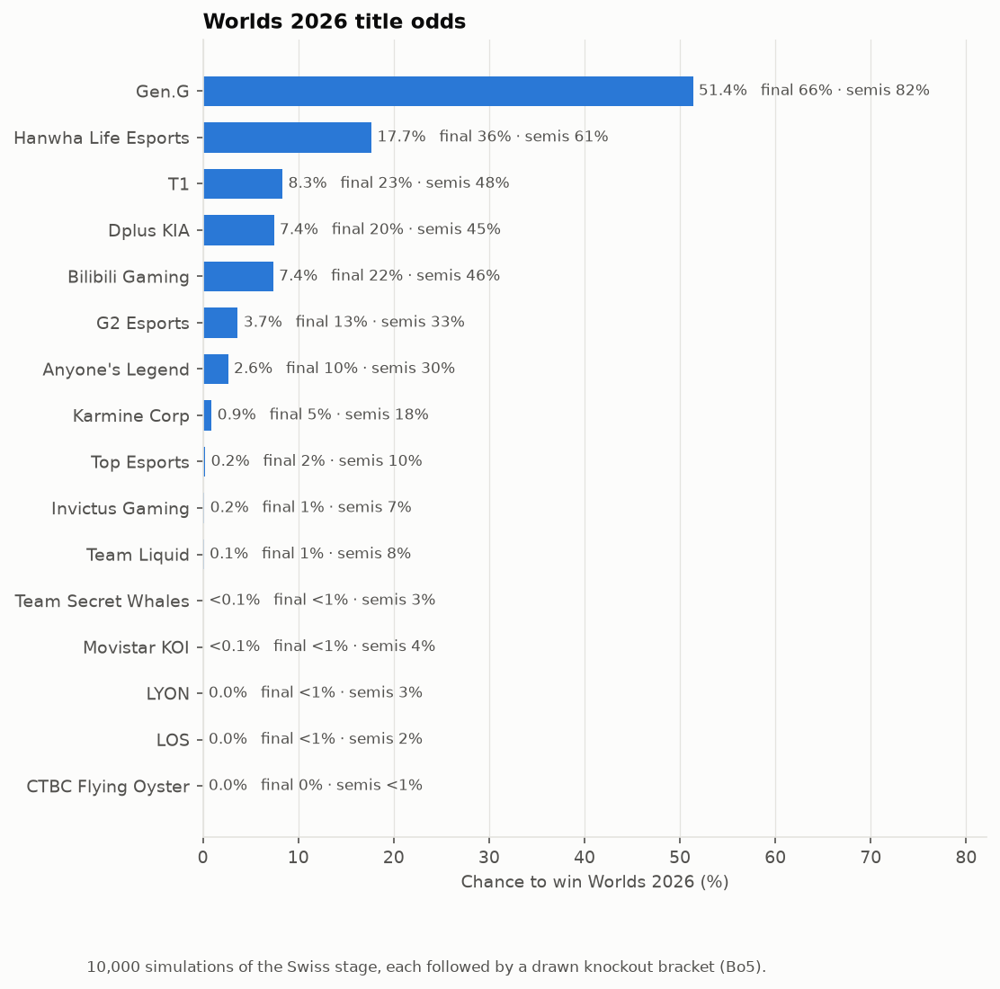
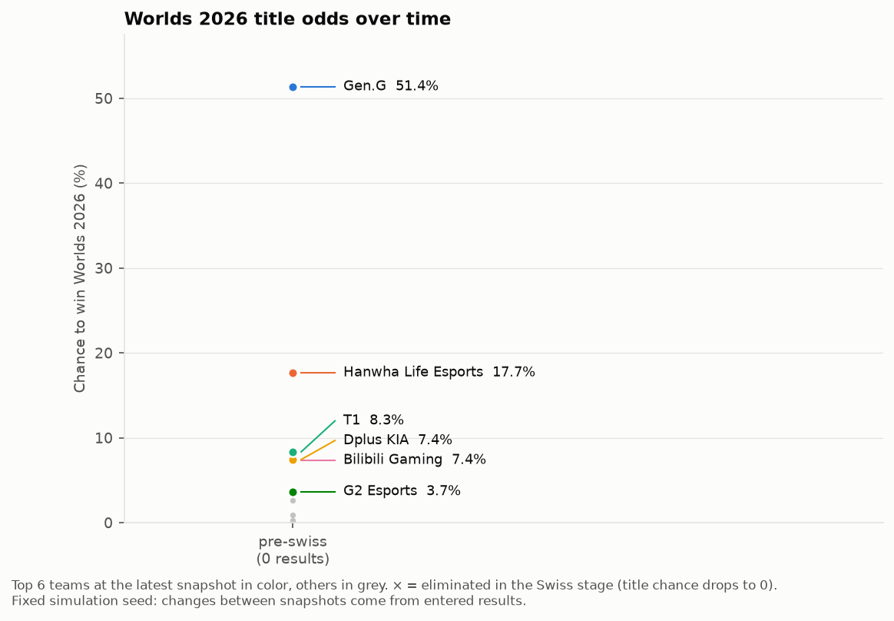
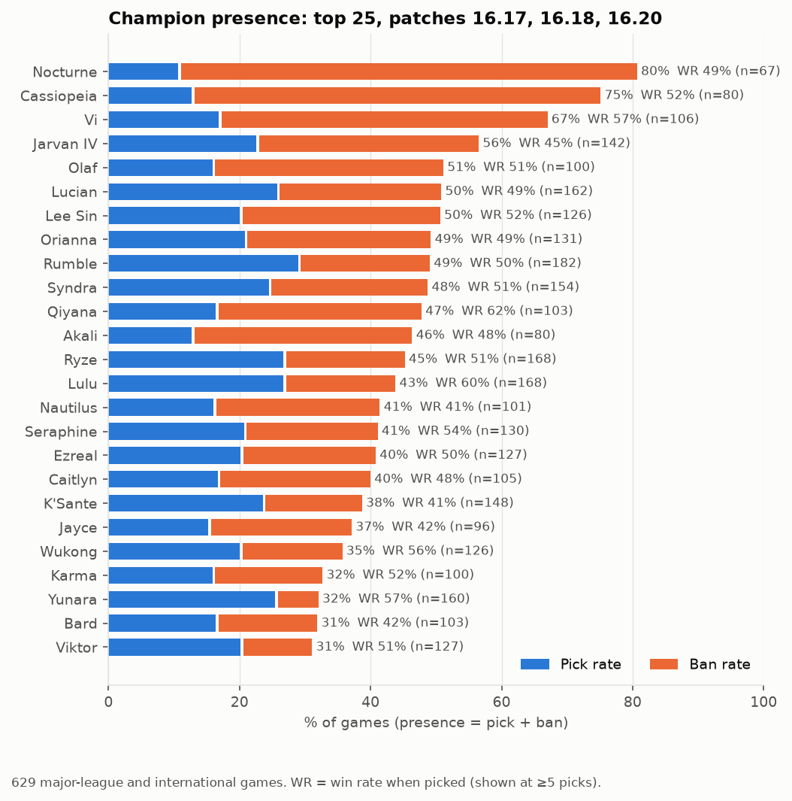
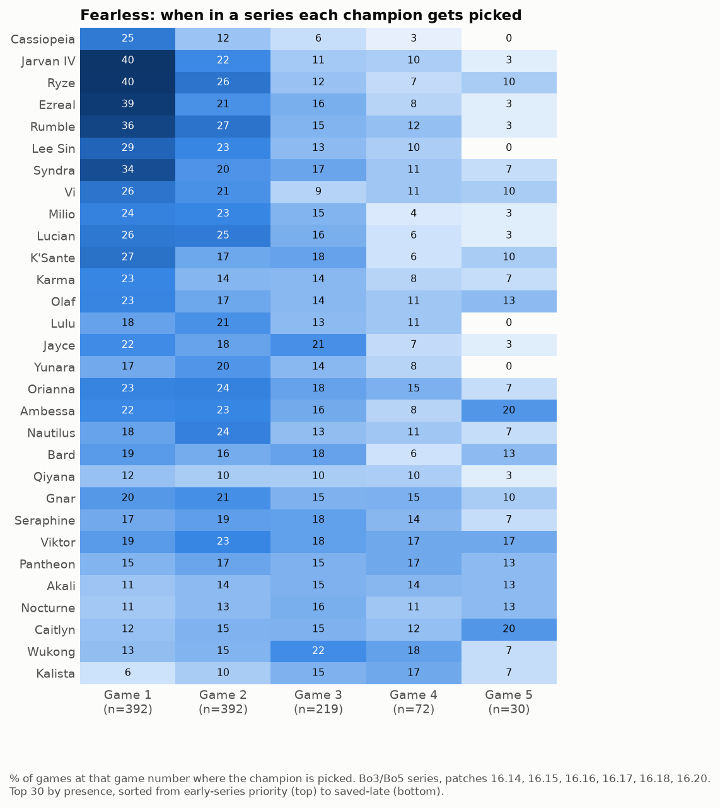
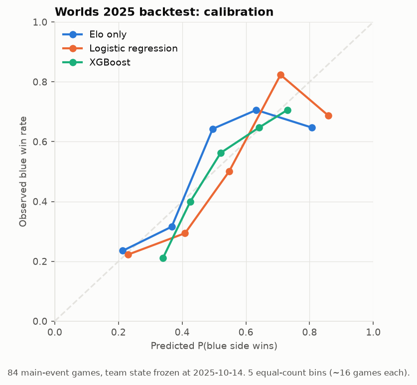

# LoL Worlds 2026 Predictor

Forecasts the League of Legends World Championship 2026 from pro match data, using a region-adjusted Elo model and a Monte Carlo simulation of the Swiss and knockout stages.



## Current prediction

**As of pre-Swiss, Oct 2026** (ratings use games through Oct 18, 2026; 10,000 simulated tournaments)

| Team | Title chance |
|---|---|
| Gen.G | 51.4% |
| Hanwha Life Esports | 17.7% |
| T1 | 8.3% |
| Dplus KIA | 7.4% |
| Bilibili Gaming | 7.4% |

Full per-team odds for reaching the knockouts, semifinals, final and title are in [`outputs/sim_results.csv`](outputs/sim_results.csv).

## Odds over time



Each point is a snapshot of the title odds taken after a batch of results is entered (so far only `pre-swiss`, with 0 results). The six teams with the highest odds at the latest snapshot are shown in color, and an × marks a team eliminated in the Swiss stage. Every snapshot uses the same simulation seed, so a change between snapshots comes from the entered results, not from simulation noise. The data behind the chart is in [`outputs/odds_history.csv`](outputs/odds_history.csv).

## How it works

```
Oracle's Elixir CSVs -> SQLite -> features -> model -> Swiss sim -> knockout sim
```

1. **CSV:** two seasons (2025 and 2026) of per-game data from Oracle's Elixir: 19,797 games and 647 teams.
2. **SQLite:** the raw rows are cleaned into games, series, team and player tables. Series are rebuilt from game order, Worlds qualifiers are separated from the main event, and cross-region games are flagged.
3. **Features:** a single pass through the games in date order records each team's state *before* each game: region-adjusted Elo, recent form, form against expectations, gold difference at 15 minutes and champion pool depth.
4. **Model:** a logistic regression on the difference between the two teams' features predicts single-game win probability, and series probabilities are derived from it.
5. **Swiss sim:** 10,000 runs of the 16-team Swiss stage, with random draws within each win-loss group, no rematches, and Bo1/Bo3 by round and record.
6. **Knockout sim:** each Swiss run continues into a quarterfinal draw following the Worlds rules, then a Bo5 bracket, giving each team's title chance.

Each stage has a short write-up with the decisions made and the checks run, in [`notes/`](notes/).

## Champion analysis



Nocturne is the most contested champion on patches 16.17, 16.18 and 16.20 at 80% presence, and 70% of that is bans.



Under Fearless draft no champion repeats within a series, so the game number a champion gets picked in shows its priority. Jarvan IV and Ryze are each picked in 40% of game 1s, while Aphelios, Jinx and Thresh tend to be held for later games.

Team-level pool depth and signature champions are in [`outputs/team_pool_depth.png`](outputs/team_pool_depth.png) and [`outputs/signature_champs.png`](outputs/signature_champs.png).

## Model and backtest

The model was tested on the Worlds 2025 main event (84 games, 41 series). It was trained only on games before the event started (Oct 14, 2025), and each team's features were frozen at that date, as if the forecast had been made on day one.

| Model | Log loss | Brier score | Accuracy |
|---|---|---|---|
| 50/50 baseline | 0.693 | 0.250 | n/a |
| Elo only | 0.615 | 0.213 | 69.0% |
| **Logistic regression (used)** | **0.603** | **0.207** | **69.0%** |
| XGBoost | 0.618 | 0.213 | 70.2% |

Lower is better for log loss and Brier score. The logistic regression also had the best series-level log loss (0.525, against 0.556 for Elo only). XGBoost did not improve on it with about 2,000 training games.



Details on Elo tuning, the season-to-season rating regression and feature weights are in [`notes/03-model.md`](notes/03-model.md).

## Quickstart

Requires Python 3.13.

```bash
python -m venv .venv
source .venv/bin/activate
pip install -r requirements.txt
```

Download the yearly match data CSVs from [Oracle's Elixir](https://oracleselixir.com/tools/downloads) and save them in `data/raw/` with names ending in `_oe.csv`:

```
data/raw/2025_oe.csv
data/raw/2026_oe.csv
```

Run the pipeline step by step:

```bash
python -m worlds data             # CSVs -> data/processed/worlds.db
python -m worlds champs           # champion analysis and charts
python -m worlds model            # Elo tuning, Worlds 2025 backtest, saves the model
python -m worlds swiss            # Swiss stage simulation
python -m worlds knockout         # knockout simulation chained from the Swiss runs
python -m worlds knockout --fixed # knockout simulation from a known bracket
```

Or run `python -m worlds all`. Run the tests with `python -m pytest -q`.

Tournament settings (teams, round 1 draw, Swiss rules, results) live in [`config/worlds2026.yaml`](config/worlds2026.yaml).

## Updating during Worlds

**After Swiss matches are played,** add them to `results` in the config, using the team names from the `teams` list:

```yaml
results:
  - {round: 1, winner: Gen.G, loser: Invictus Gaming, score: "1-0"}
```

Then rerun:

```bash
python -m worlds swiss
python -m worlds knockout --snapshot swiss-r1   # label is optional; it adds a point to the history
python -m worlds history                        # redraws outputs/odds_history.png
```

Re-running a snapshot label replaces that snapshot instead of adding a duplicate. If results were added but `swiss` wasn't rerun, `knockout` stops and asks for `swiss` to be run first, so a snapshot never mixes old Swiss runs with new results.

Enter every result of a round before adding results from the next one. The simulation rejects unknown team names, round 1 results that don't match the draw, and pairings between teams with different records.

**To also update team ratings** with the latest games, download a fresh Oracle's Elixir CSV into `data/raw/` and run `data`, `model`, `swiss` and `knockout` in that order. Adding results alone does not change ratings.

**After the Swiss stage,** add the real quarterfinals in bracket order (the winners of the first two pairs meet in one semifinal) and run the fixed mode:

```yaml
knockout:
  bracket: [[Team A, Team B], [Team C, Team D], [Team E, Team F], [Team G, Team H]]
```

```bash
python -m worlds knockout --fixed --snapshot post-swiss
python -m worlds history
```

## Limitations

- **No roster or patch-change modeling.** Ratings carry over between seasons with a fixed 50% pull toward the region average. A roster swap or a large patch shift mid-season is only picked up as results come in.
- **Games in a series are treated as independent.** Fearless draft depletes champion pools as a series goes on. The data shows no fade in the favorite's edge in game 2, but games 4 and 5 are rare (72 and 30 in the sample), so the end of a Bo5 is the least tested part.
- **Small international sample.** Region strength is learned from 530 cross-region games at international events (minor-region tournaments excluded), and the backtest covers 84 games. Differences of around 0.01 in log loss between models are not conclusive.
- **Heavy favorites may be overrated.** In the backtest, games where Elo gave one side more than 80% were won less often than predicted. This likely inflates the title chance of the top team.
- **One modeling choice was made after seeing the backtest.** Training on major-league and international games only (instead of all leagues) was adopted because it improved the Worlds 2025 results, so the backtest numbers are somewhat optimistic.
- **No draft or matchup modeling.** The model uses team-level features only. Champion pool depth was tested and carried no predictive weight.
- **Ratings are frozen during the event.** Entering results conditions the bracket but does not update team strength until the data is refreshed.
- **Simulation noise.** With 10,000 runs, a 50% figure is accurate to about 1 percentage point. A 0.0% title chance means no title in 10,000 runs, not an impossible outcome.

## Data credit

Match data from [Oracle's Elixir](https://oracleselixir.com) by Tim Sevenhuysen. League of Legends and the World Championship are trademarks of Riot Games, Inc. This project is not endorsed by or affiliated with Riot Games.
