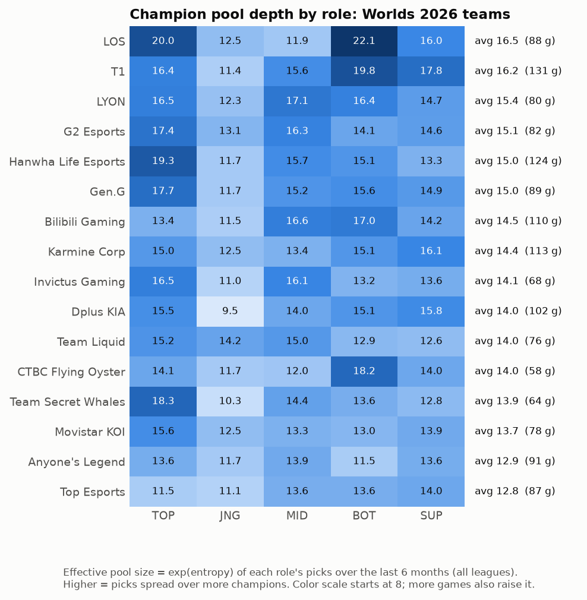
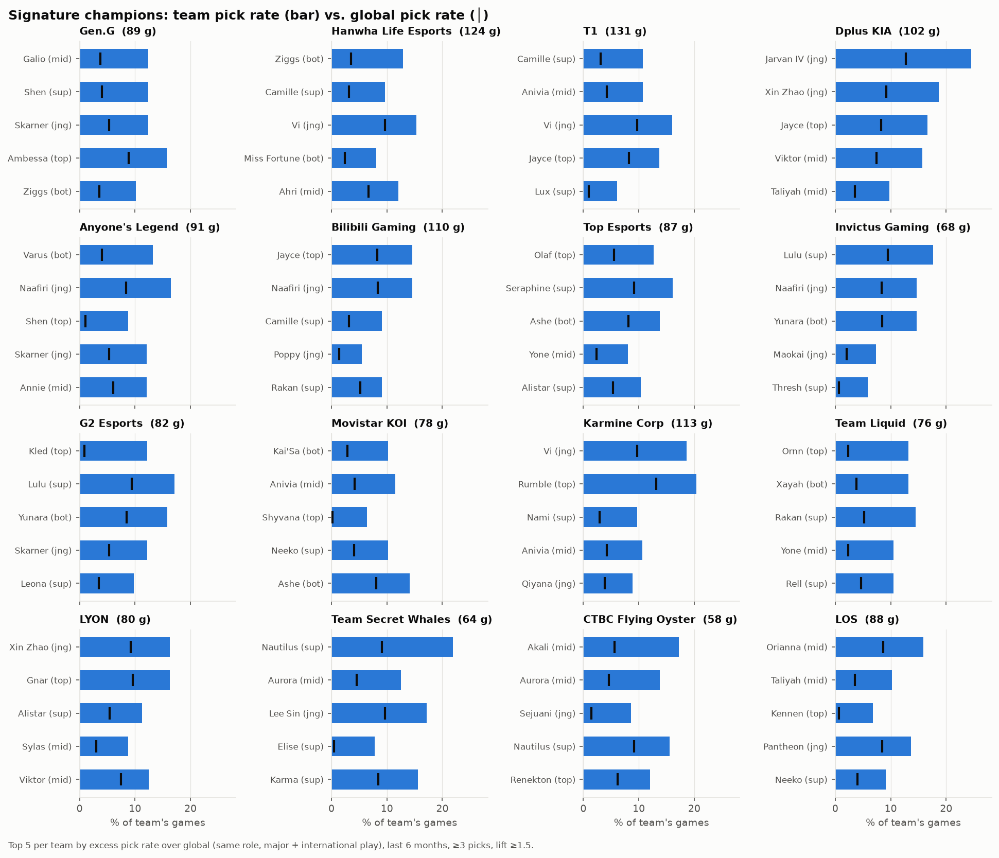

# Step 2: Champion analysis

**Command:** `python -m worlds champs`
**Code:** `worlds/champions.py`, `worlds/plots.py`
**Output:** SQLite tables `champ_stats`, `champ_fearless`, `team_pools`, `team_signatures`, and four charts in `outputs/`

## Scope

The champion statistics cover the three most recent patches, **16.17, 16.18 and 16.20** (there was no 16.19). 16.20 is the Worlds patch. We used games from the six major leagues (LCK, LPL, LEC, LCS, CBLOL, LCP), cross-region international games, and the Worlds main event, for a total of **629 games**.

## Champion presence

Presence is the share of games in which a champion was either picked or banned.

- **Nocturne** is the most contested champion at 80% presence, almost entirely through bans. **Cassiopeia** (75%) and **Vi** (67%) follow.
- Among picked champions, **Qiyana** (62% win rate over 103 games) and **Lulu** (60% over 168) stand out.
- **Nautilus** (41% over 101 games) and **K'Sante** (41% over 148) are picked often but lose more than they win.

Win rates are shown only for champions picked at least 5 times. Each one comes with a 95% Wilson confidence interval in the `champ_stats` table.

## Fearless draft

We first checked whether the data reflects Fearless rules. Across all 846 Bo3 and Bo5 series in the 2026 major leagues, **no champion was ever picked twice in the same series, by either team**. Every champion therefore has an effective "when to use it" decision, which makes this question worth answering.

To get enough games 4 and 5, this chart uses a wider window of the last six patches (16.14–16.20). It shows, for each game number, the percentage of games in which the champion was picked.

- **Used early in a series:** Cassiopeia, Jarvan IV, Ryze, Ezreal, Rumble, Lee Sin, Syndra and Vi. Jarvan IV and Ryze are each picked in 40% of game 1s.
- **Held for later games:** Aphelios, Jinx, Thresh, Kennen, Yuumi, Neeko, Maokai and Cho'Gath.
- The game 4 and game 5 columns rest on only 72 and 30 games, so individual cells there are noisy.

## Team champion pools

Pool depth is measured over each team's last six months of games in all competitions. For each role we compute the *effective pool size*, exp(entropy) of that role's champion picks. A role that spreads its games evenly over 15 champions scores 15. A role that plays one champion most of the time scores close to 1.

- **LØS (16.5)** and **T1 (16.2)** have the deepest pools. Both have unusually varied bot lanes (22.1 and 19.8).
- **Top Esports (12.8)** and **Anyone's Legend (12.9)** have the narrowest pools.
- **Dplus KIA's jungle (9.5)** is the most concentrated single role of any Worlds team.
- Jungle is the narrowest role for 13 of the 16 teams. The exceptions are Team Liquid (narrowest at support), LØS (mid) and Anyone's Legend (bot).

One caveat: teams with more games tend to score higher, because they've had more chances to play different champions. The game count next to each team should be read alongside the score.

## Signature champions

A signature champion is one a team plays much more often than the rest of the field in the same role. We rank champions by how many percentage points more often the team picks them than everyone else does. Each champion must have at least 3 picks and be picked at least 1.5× as often as the field.

Our first version ranked champions by the ratio alone. That favored champions a team had played only three or four times (Anivia top, Mel bot). Switching to the percentage-point difference surfaces genuine comfort picks:
- Dplus KIA's **Jarvan IV** (25% of their games, against about 13% for the field)
- Team Secret Whales' **Nautilus**
- CTBC Flying Oyster's **Akali**
- Karmine Corp's **Rumble**
- G2's **Kled**
- Team Liquid's **Ornn**

## Checks
- Unit tests cover the Wilson confidence interval: it brackets the estimate, narrows as sample size grows, and returns nothing for zero games.
- We reviewed each chart by eye for label overlaps and readability. The chart colors come from a palette that is checked to stay readable for people with color vision deficiency.
