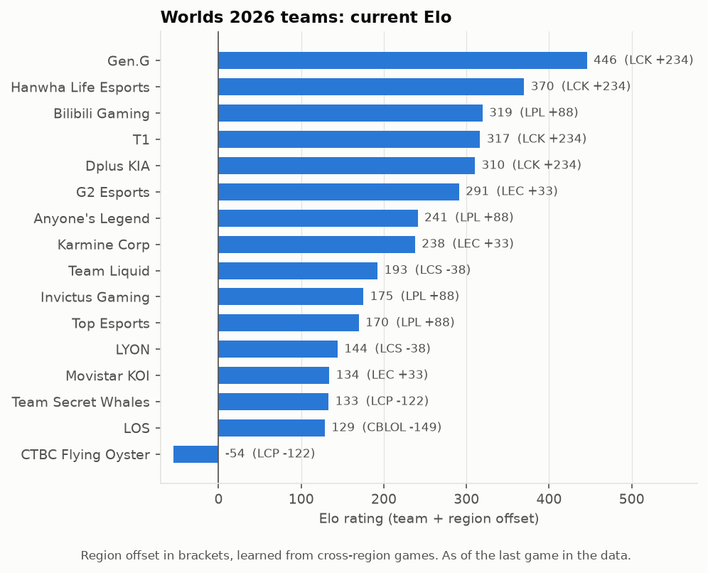

# Step 3: Win-probability model

**Command:** `python -m worlds model`
**Code:** `worlds/features.py`, `worlds/model.py`, `worlds/series.py`
**Output:** `data/processed/model.joblib`, SQLite tables `team_state`, `game_features` and `backtest_results`, and two charts in `outputs/`

## Approach

We built team features in a single pass through every game in date order. Before each game we record both teams' current state, and only then update it with the result. As a result, no feature ever uses the game it describes or anything after it. A unit test checks this: changing the result of the last game leaves every earlier game's features unchanged.

Each team carries five pieces of state:

- **Elo rating.** This is a team rating plus a shared **region offset**. Domestic games move only team ratings. Cross-region games also move the two regions' offsets, which is how the model learns that, for example, an average LCK team is stronger than an average LCS team.
- **Form.** A rolling average of recent results, weighted toward the last ~10 games.
- **Form against expectations.** The same rolling average, but of (result − Elo's predicted win chance). It captures teams that are winning more than their rating says they should.
- **Gold difference at 15 minutes.** A rolling average, using complete-data games only.
- **Champion pool depth.** The same effective pool size as in Step 2, computed over each team's last 40 games.

A model then predicts the outcome of a game from the *differences* between the two teams' values, plus which side (blue or red) each team is on.

## Tuning the Elo rating

We tested three values of K (how far a rating moves after one game) and three values of region K (how far region offsets move). We scored each combination on major-league and international games from June 2025 up to the start of Worlds 2025, so Worlds itself never influenced the choice.

| K | Region K | Log loss (all) | Log loss (international) |
|---|---|---|---|
| **24** | **20** | **0.652** | **0.682** |
| 24 | 10 | 0.652 | 0.683 |
| 24 | 0 | 0.655 | 0.691 |
| 32 | 10 | 0.654 | 0.686 |
| 48 | 10 | 0.660 | 0.691 |

Lower log loss is better, and a coin flip scores 0.693. K = 24 was best. Turning off region offsets (region K = 0) made international predictions about as good as a coin flip, which confirms that the region adjustment matters. Region K = 10 and 20 tied overall, and we broke the tie on international games, because Worlds is mostly cross-region matches.

**One fix along the way.** At first, European Masters games (French, Spanish and other regional European leagues playing each other) also moved region offsets. That pushed the French league's offset above the LCK's. Those regions almost never play the major regions, so nothing anchors their level. We now leave EM and the academy showcase out of the region offsets. Those games still update the individual teams' ratings.

## Season regression

Rosters change between seasons, so at the start of 2026 each team's rating is pulled partway back toward its region's average. Region offsets are pulled back more gently. This setting has no effect on the Worlds 2025 backtest, which takes place before any season boundary in our data. We therefore tested it on January–March 2026 games instead:

| Regression | 0 (carry over) | 0.25 | **0.5** | 0.75 | 1 (full reset) |
|---|---|---|---|---|---|
| Log loss | 0.681 | 0.672 | **0.669** | 0.671 | 0.678 |

Halfway regression works best, which supports the default of 0.5 in the config.

We had also planned a lighter regression between splits within a season. We didn't implement it.

## Worlds 2025 backtest

We trained each model on 2,137 major-league and international games played before 2025-10-14. We then predicted all 84 games of the Worlds 2025 main event. **Every team's features were frozen at the start of the tournament.** Even the final used the ratings teams had before their first Worlds game, exactly as a forecast made on day one would.

| Model | Log loss | Brier | Game accuracy | Series log loss | Series accuracy (41 series) |
|---|---|---|---|---|---|
| Coin flip | 0.693 | 0.250 | – | 0.693 | – |
| Elo only | 0.615 | 0.213 | 69.0% | 0.556 | 78.0% |
| Elo + side (fitted) | 0.622 | 0.214 | 67.9% | 0.559 | 78.0% |
| **Logistic regression (all features)** | **0.603** | **0.207** | 69.0% | **0.525** | 73.2% |
| XGBoost | 0.618 | 0.213 | 70.2% | 0.545 | 75.6% |

Logistic regression is the best model on log loss and Brier score, both for single games and whole series, so it's the model we saved. XGBoost didn't beat it. With about 2,000 training games and a handful of features, the extra flexibility of trees mostly adds noise.

With only 84 games, each point in the calibration chart covers about 16 games, so it's noisy. Even so, the predictions follow the diagonal reasonably well. Where Elo strongly favors blue (above 80%), the favorites won less often than predicted.

**Caveats.**
- 84 games is a small test set. Differences of about 0.01 in log loss between models aren't conclusive.
- We restricted training to major-league and international games *after* seeing that it improved the backtest. Before that change, logistic regression scored 0.631 and XGBoost 0.645, both trained on all leagues. That decision was made with knowledge of the test set, so the backtest numbers are somewhat optimistic.

## What the model learned

Here are the standardized logistic-regression weights in the final model, trained on all data up to 2026-10-18:

| Feature | Weight |
|---|---|
| Elo difference | +0.63 |
| Experience (log games played) | +0.21 |
| Form difference | −0.18 |
| Blue side | +0.16 |
| Form against expectations | +0.16 |
| Gold@15 difference | +0.10 |
| Pool depth difference | −0.01 |

- **Elo** carries most of the signal.
- **Blue side** is a real advantage: blue won 54.7% of major-league and international games from June 2025 on.
- **Raw form** gets a negative weight because Elo already counts recent wins. What adds information beyond Elo is *form against expectations*.
- **Pool depth** has essentially no predictive value. A deeper pool doesn't make a team more likely to win a given game.

## From games to series

We convert a game win probability *p* into a series win probability by treating the games as independent:
- Bo3: p²(3 − 2p)
- Bo5: p³(10 − 15p + 6p²)

We checked how well this assumption holds under Fearless by looking at how often the pre-series favorite wins each game of 2026 major-league series:

| Game | 1 | 2 | 3 | 4 | 5 |
|---|---|---|---|---|---|
| Favorite win rate | 62.1% | 64.7% | 59.7% | 56.6% | 52.8% |
| Games | 846 | 846 | 459 | 122 | 53 |

The favorite's edge doesn't fade in game 2, the first game where both teams have lost champions to Fearless. It does shrink in games 3–5, but that's expected even with independent games: a series only reaches game 3 if the underdog has already won one, so those series are closer than average. We kept the independence assumption.

## Current ratings

Based on games up to 2026-10-18, **Gen.G (446)** is the clear top-rated team, followed by Hanwha Life Esports (370) and Bilibili Gaming (319). The region offsets put the LCK well ahead (+234), followed by the LPL (+88), LEC (+33), LCS (−38), LCP (−122) and CBLOL (−149). CTBC Flying Oyster is the only Worlds team rated below zero (−54).

The model's single-game win probabilities for the Swiss round 1 matchups:

| Matchup | P(first team wins) |
|---|---|
| Gen.G vs Invictus Gaming | 81.5% |
| Team Liquid vs CTBC Flying Oyster | 76.7% |
| Bilibili Gaming vs Movistar KOI | 74.0% |
| Hanwha Life Esports vs Top Esports | 72.8% |
| Anyone's Legend vs Karmine Corp | 55.3% |
| Team Secret Whales vs LYON | 51.8% |
| G2 Esports vs Dplus KIA | 45.6% |
| LØS vs T1 | 21.9% |

## Checks
- Series formulas: 50% stays 50%; the conversion is increasing and symmetric; Bo5 favors the stronger team more than Bo3.
- Elo: domestic games are zero-sum; region offsets move only on international games; season regression matches the formula.
- No leakage: changing the last game's result leaves all earlier features unchanged.
