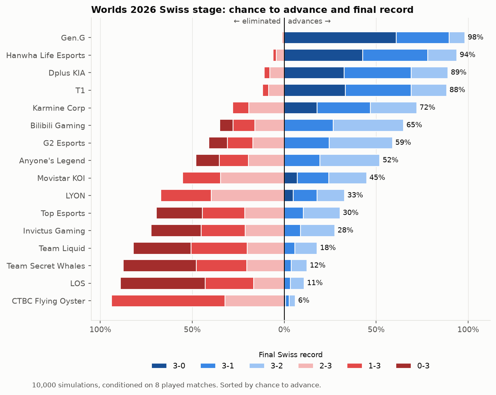

# Step 4: Swiss stage simulation

**Command:** `python -m worlds swiss`
**Code:** `worlds/swiss.py`
**Output:** `outputs/swiss_results.csv`, `outputs/swiss_records.png`, and the SQLite tables `swiss_summary` and `swiss_sims`

## What we did

We simulated the Worlds 2026 Swiss stage 10,000 times using the Step 3 model. Each run plays out the five rounds of the Swiss stage. A team advances with 3 wins and is eliminated with 3 losses. Every run ends with eight teams through to the knockout stage.

From those runs we estimate two things for each team: the chance it advances, and the chance of each final record (3-0, 3-1, 3-2, 2-3, 1-3 or 0-3). Each run's records and opponents are also saved, so that the knockout simulation in the next step can start from them.

## How a run works

- **Round 1** uses the official draw from the config.
- **Later rounds** pair teams with the same win-loss record at random. Teams that have already met are never paired again. Two teams from the same region are allowed to meet from round 2 onward, as the config sets. If no valid pairing exists within a group, these constraints are relaxed. In the 10,000 runs no rematch ever happened.
- **Match format:**
  - Rounds 1–2 are best-of-one.
  - From round 3 onward, any match that can send a team through or knock it out is a best-of-three: the 2-0 and 0-2 matches in round 3, everything in round 4, and the 2-2 matches in round 5.
  - The round-3 matches between 1-1 teams decide neither, so they stay best-of-one.

  The first version of the simulation got this rule wrong; see the revision section below.
- **Win chances** come from the Step 3 model with ratings as of 2026-10-18. They are averaged over blue and red side, since the side choice changes during a series. A best-of-three uses the series formula from Step 3.

## Revision: 1-1 matches stay best-of-one

My first version of the simulation treated every match from round 3 onward as a best-of-three. After reviewing the format, I realized that the best-of-three only applies to matches that decide advancement or elimination. The 1-1 teams in round 3 still play a best-of-one, because neither team can qualify or be knocked out in that match. I revised the simulation to use that rule and reran it with the same random seed.

### How the two versions compare

| Team | First version | Revised | Change | 3-1 change | 1-3 change |
|---|---|---|---|---|---|
| Gen.G | 96.3% | 95.7% | −0.7 | −2.1 | +0.4 |
| Hanwha Life Esports | 88.8% | 87.5% | −1.3 | −1.8 | +0.8 |
| T1 | 81.8% | 81.1% | −0.7 | −0.7 | +0.8 |
| Bilibili Gaming | 81.1% | 80.2% | −0.9 | −0.9 | +1.2 |
| Dplus KIA | 78.7% | 78.0% | −0.7 | −0.8 | +0.9 |
| G2 Esports | 69.5% | 68.3% | −1.3 | −0.4 | +1.2 |
| Anyone's Legend | 66.7% | 66.1% | −0.6 | −0.4 | +0.8 |
| Karmine Corp | 53.9% | 53.2% | −0.7 | ±0.0 | +1.1 |
| Team Liquid | 37.1% | 38.3% | +1.2 | +1.1 | −0.6 |
| Top Esports | 37.3% | 37.7% | +0.4 | +1.1 | +0.4 |
| Invictus Gaming | 31.6% | 32.3% | +0.7 | +0.8 | +0.2 |
| Movistar KOI | 22.1% | 22.8% | +0.7 | +0.7 | −0.6 |
| Team Secret Whales | 21.5% | 22.7% | +1.2 | +1.1 | −1.4 |
| LYON | 18.3% | 19.8% | +1.5 | +1.2 | −1.8 |
| LØS | 13.7% | 14.6% | +0.9 | +0.9 | −1.1 |
| CTBC Flying Oyster | 1.5% | 2.0% | +0.5 | +0.3 | −2.4 |

The "First version" and "Revised" columns are each team's chance to advance. The three change columns are in percentage points.

The first version's full results are kept in the project history, in the commit "Add Swiss stage simulation with pairing rules".

### What changed and why

**The favorites lost a little, and the underdogs gained the same amount.** The eight teams most likely to advance lost 6.9 percentage points between them, and the other eight gained exactly 6.9. The total still adds up to eight qualifiers. No team moved by more than 1.5 points. The largest gains went to LYON (+1.5), Team Liquid and Team Secret Whales (+1.2 each), and the largest losses to Hanwha Life Esports and G2 (−1.3 each).

**The reason is that a best-of-one is closer to a coin flip than a best-of-three.** A team with a 70% chance of winning one game wins a best-of-three about 78% of the time. Switching the 1-1 matches back to best-of-one therefore gives the weaker team in each of those matches a better chance. The first version made the stronger team too safe in exactly one spot in the bracket.

**Only results that pass through a 1-1 match changed.**
- A team on the 3-1 path goes 1-1, wins its round-3 match, and then wins in round 4. That's why the favorites' 3-1 chances fell the most; Gen.G lost 2.1 points there. Those runs moved to 3-2 or to elimination instead.
- For the weaker teams the effect runs the other way. Their 3-1 chances rose and their 1-3 chances fell.
- **The 3-0 and 0-3 columns are identical in both versions, for every team.** A 3-0 or 0-3 run goes through 2-0 or 0-2 and never plays a 1-1 match. Both versions used the same random seed, so those runs played out identically. That's a useful confirmation that the revision changed only what it was meant to change.

**The shifts are small because the change is narrow.** It affects four matches per run, the round-3 1-1 group, out of 33. And it only matters when one team in that match is clearly stronger.

**Team Liquid and Top Esports swapped places.** In the first version they were 0.2 points apart (37.1% vs 37.3%). In the revised version Liquid is 0.6 points ahead (38.3% vs 37.7%). This says more about how close the two teams were than about either of them.

The revised numbers are the ones used everywhere else in these notes. They're also what the `swiss_sims` table holds for the knockout step.

## Conditioning on real results

As matches are played, they can be added to the `results` section of the config, and the simulation treats them as fixed. Those pairings and winners are locked in, and only the rest of each round's draw is simulated.

The simulation refuses results it can't interpret unambiguously:
- a team name that doesn't exist
- a round-1 result that isn't one of the official round-1 pairings
- two teams paired with different records
- results for a round when an earlier round is still incomplete

That last rule keeps every team's record at the start of a round known, rather than guessed.

The ratings themselves don't update when results are added. They only change after the source data is refreshed and Steps 1 and 3 are rerun.

As a sanity check, we added a hypothetical result in which Invictus Gaming beats Gen.G in round 1. Gen.G's chance of advancing dropped from 96% to 89%, its chance of going 3-0 fell to zero, and Invictus rose from 32% to 54%. This check was run on the first version, but the revision doesn't change how results are applied.

## Pre-tournament forecast

No Swiss matches have been played yet (the stage starts Oct 23), so this is the pre-tournament forecast, using the revised simulation.

| Team | Advance | 3-0 | 3-1 | 3-2 | 2-3 | 1-3 | 0-3 |
|---|---|---|---|---|---|---|---|
| Gen.G | 95.7% | 48.9% | 32.5% | 14.3% | 2.6% | 1.4% | 0.4% |
| Hanwha Life Esports | 87.5% | 30.3% | 35.0% | 22.2% | 7.3% | 4.1% | 1.1% |
| T1 | 81.1% | 24.6% | 32.2% | 24.3% | 10.8% | 6.6% | 1.6% |
| Bilibili Gaming | 80.2% | 23.5% | 31.6% | 25.2% | 11.5% | 6.6% | 1.7% |
| Dplus KIA | 78.0% | 17.8% | 31.6% | 28.5% | 11.9% | 7.4% | 2.8% |
| G2 Esports | 68.3% | 12.2% | 26.3% | 29.8% | 16.1% | 10.8% | 4.9% |
| Anyone's Legend | 66.1% | 12.4% | 25.3% | 28.5% | 18.0% | 11.4% | 4.5% |
| Karmine Corp | 53.2% | 7.6% | 19.3% | 26.2% | 22.4% | 16.8% | 7.6% |
| Team Liquid | 38.3% | 7.0% | 13.7% | 17.6% | 30.1% | 24.7% | 6.9% |
| Top Esports | 37.7% | 3.8% | 13.6% | 20.3% | 24.1% | 24.6% | 13.6% |
| Invictus Gaming | 32.3% | 3.0% | 10.9% | 18.4% | 25.2% | 25.9% | 16.7% |
| Movistar KOI | 22.8% | 2.2% | 7.4% | 13.1% | 25.6% | 30.4% | 21.2% |
| Team Secret Whales | 22.7% | 3.1% | 7.9% | 11.8% | 30.5% | 30.8% | 16.0% |
| LYON | 19.8% | 2.4% | 7.0% | 10.3% | 29.5% | 32.3% | 18.5% |
| LØS | 14.6% | 1.0% | 5.0% | 8.6% | 22.5% | 33.2% | 29.6% |
| CTBC Flying Oyster | 2.0% | 0.3% | 0.7% | 1.0% | 12.1% | 32.9% | 53.1% |

**Observations**
- **Gen.G is a heavy favorite to advance (96%)** and goes 3-0 in about half of the runs.
- **All four LCK teams are in the top five.** Between them, the LCK teams average 3.4 of the 8 knockout places.
- **The cut line falls around Karmine Corp (53%).** Team Liquid (38.3%) and Top Esports (37.7%) are nearly tied, but with different profiles. Liquid's favorable round-1 matchup against CTBC Flying Oyster (77%) gives it more 3-0 runs (7.0% vs 3.8%). Top Esports opens against Hanwha Life. It goes 0-3 more often (13.6% vs 6.9%), but it also finishes 3-2 more often (20.3% vs 17.6%).
- **CTBC Flying Oyster advances in only 2.0% of runs.** It's the only Worlds team rated below zero, and it goes 0-3 more often than not.

## Checks
- The advance probabilities add up to 8.00 teams in both versions, as they must.
- Unit tests (`tests/test_swiss.py`), on a synthetic 16-team field:
  - every run ends with exactly two 3-0 teams, three 3-1, three 3-2, three 2-3, three 1-3 and two 0-3;
  - no team plays more than five matches, and there are no rematches;
  - with overwhelming strength gaps, the best team always goes 3-0;
  - best-of-one and best-of-three are assigned correctly by round and record, including the 1-1 group in round 3;
  - results that are entered are respected in every run;
  - each kind of invalid result raises a clear error.
- The full test suite (15 tests) passes, and the simulation takes about 2 seconds.
