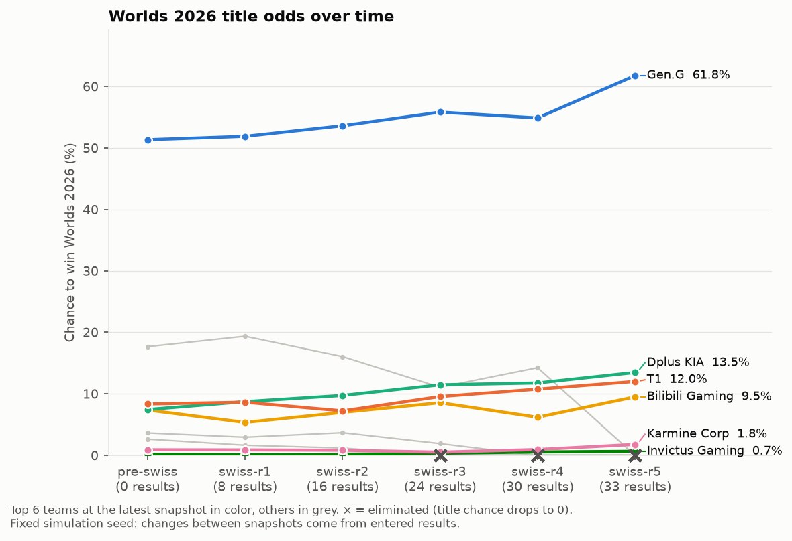

# Extra: Title odds over time

**Commands:** `python -m worlds knockout --snapshot <label>` and `python -m worlds history`
**Code:** `worlds/history.py`, plus small additions to `worlds/knockout.py`, `worlds/swiss.py` and `worlds/__main__.py`
**Output:** `outputs/odds_history.csv`, `outputs/odds_history.png`

## What we did

We added a way to record how the title odds change as the tournament goes on. Running the knockout simulation with `--snapshot <label>` saves one row per team with the label, the time, the number of results in the config, and each team's chances of advancing from the Swiss stage, reaching the semifinals, reaching the final and winning the title. Labels are free text; the intended ones are `pre-swiss`, `swiss-r1` through `swiss-r5`, and `post-swiss`.

Running the same label again replaces its rows instead of adding a second copy, and the snapshot keeps its original place in the sequence. A correction to `swiss-r2`, for example, stays between `swiss-r1` and `swiss-r3`.

`python -m worlds history` draws the chart from the saved rows. It plots each team's title chance across the snapshots, in the order they were taken:
- The six teams with the highest title chance at the latest snapshot are shown in color, with a label at the end of each line.
- The other teams are grey.
- A team knocked out in the Swiss stage has its line end at 0, marked with an ×.

## Keeping snapshots comparable

**Fixed seed.** The Swiss and knockout simulations both use the fixed seed from the config (2026). Running the same inputs twice gives the same numbers, so a change between two snapshots comes from the results that were added, not from simulation noise. As a check, the `pre-swiss` snapshot reproduced the earlier Step 5 figures exactly; Gen.G is at 51.4% in both.

**A guard against stale Swiss runs.** The knockout simulation builds on the saved Swiss runs. Without a check, someone could add new results, run only the knockout step, and save a snapshot labeled with the new results but computed from the old Swiss runs. To prevent that:
- the Swiss step now saves a fingerprint of everything it depended on: the teams, the round 1 draw, the results, the Swiss rules, the number of runs, the seed and the saved model;
- the chained knockout step refuses to run if that fingerprint no longer matches, and asks for the Swiss step to be rerun.

The guard fired on the first try, because the Swiss runs on disk predated the fingerprint. After rerunning the Swiss step, the snapshot went through.

**Stable colors.** Each highlighted team keeps the same color from snapshot to snapshot. Colors are assigned by the teams' order in the first snapshot, so two teams trading places later doesn't swap their colors. We checked this, along with the elimination markers, by drawing a chart from made-up data with four snapshots and four eliminations. That file was kept outside the project and isn't part of the outputs.

## Current state

There are six snapshots, one before the Swiss stage and one after each of its five rounds (`pre-swiss`, `swiss-r1` to `swiss-r5`). The first, `pre-swiss`, matches the pre-tournament title odds in Step 5: Gen.G 51.4%, Hanwha Life Esports 17.7%, T1 8.3%, Dplus KIA 7.4%, Bilibili Gaming 7.4%.

After all 33 Swiss results, the title odds are Gen.G 61.8%, Dplus KIA 13.5%, T1 12.0% and Bilibili Gaming 9.5%. The biggest single move came in round 5. Hanwha Life Esports, second favorite for most of the Swiss stage, lost to Bilibili Gaming and was eliminated at 2-3, so its 14.3% title chance dropped to zero.

## Keeping a copy of every stage

Later, we also started saving the full output of every snapshot, not just its row in the history file. Each snapshot now gets its own folder under `outputs/snapshots/<label>/`, containing the title odds chart, the Swiss records chart and both CSVs as they stood at that point. Each saved chart has the stage in its title (for example "Worlds 2026 title odds: swiss-r3"), so the copies can be told apart.

This only began after the Swiss stage had finished, so the first six folders (`pre-swiss` through `swiss-r5`) were rebuilt afterwards. We re-ran each stage with only the results known at that point, using the same seed and model. All six reproduced their original numbers in the history file exactly, which also confirms the fixed seed works as intended. The config file wasn't changed during the rebuild.

For the knockout stage, the fixed-bracket mode can now take results too (`knockout.results`). This lets the history continue through the quarterfinals, semifinals and final. A team that loses a knockout series is marked × on the chart, the same as a team eliminated in the Swiss stage.

## Checks
- Saving the same label twice leaves one set of rows, with the newer numbers.
- Replacing a label in the middle of the history keeps the snapshot order.
- The Swiss fingerprint changes when results are added.
- Running the real `pre-swiss` snapshot twice still leaves exactly 16 rows.
- `--snapshot` is rejected with any command other than `knockout` or `all`.
- Saving a snapshot folder again replaces it rather than adding a second one.
- Entered knockout results are respected in every run, and a semifinal or final entered before the series that feed it is rejected.
- The elimination rule marks teams knocked out in the Swiss stage or in any knockout round, but not teams that are still alive with very small odds.
- The full test suite (33 tests) passes.
